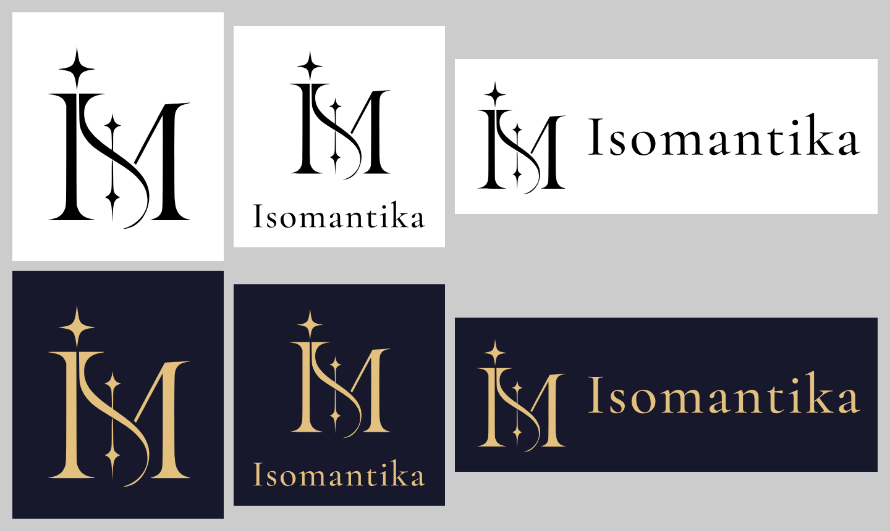

# Isomantika brandbook

What the Isomantika brand is made of and how to use it: name, logo, colours, typography and the files for the
website, the app and print.

## Name

- **Isomantika** — one word, capital `I`, the rest lowercase. Not `IsoMantika`, `ISOMANTIKA` or `Isomantica`.
- Formerly _Mantikai_: renamed in October 2026 because of trademark registration issues.
- Tagline: **AI tarot readings**.
- Domain: `isomantika.com`, support: `support@isomantika.com`.

## Logo

The mark is the monogram **I-S-M** (_IsoMantika_): a tall serif `I` with a four-pointed star as its dot, a ribbon `S`
flowing from the `I` into the `M`, and an axis of small stars inside the `M`. It is drawn as a single vector path —
the source is [`isomantika-mark-source.svg`](isomantika-mark-source.svg) (395 × 490).

| Version    | Use                                                                                 |
| ---------- | ----------------------------------------------------------------------------------- |
| Mark       | App icon, favicon, avatars, small spaces, anywhere the name is already shown nearby |
| Vertical   | Default lockup: square and portrait formats, splash screens, documents              |
| Horizontal | Wide spaces: banners, email signatures, presentations                               |

### Files

All in [`logo/`](logo): `isomantika-{mark,vertical,horizontal}-{bw,color}.{svg,pdf,png,jpg}`.

- `bw` — black on white. Use it for print, documents and the trademark application.
- `color` — gold on midnight, the main on-screen look.
- `svg`, `pdf` — vectors, any size. The wordmark is converted to outlines: no fonts are needed to open them.
- `png` — 2400 px wide; `jpg` — black-and-white versions only, for forms that do not accept PNG.

### Wordmark

`Isomantika` in **Cormorant Garamond Medium (500)** with +0.04 em letter spacing, converted to outlines. Use the files,
don't retype it. Exception — interfaces: the site header sets the name as live text in Cormorant Garamond Bold (700)
next to the mark, so it stays crisp at any size. In the vertical lockup the word is 1.55× the width of the mark; in the horizontal one its
cap height is 30 % of the mark height.

### Clear space and minimum size

- Keep free space around the logo of at least 1/7 of the mark height on every side (the files already include it).
- Mark: at least 16 px on screen (favicon) and 8 mm in print.
- Lockups: the word must stay at least 12 px / 3 mm tall.

### Don't

- Don't stretch, rotate, slant or redraw the mark; don't change the proportions between the mark and the word.
- Don't use colours outside the palette; gold goes on midnight, never on white (contrast 1.7 : 1).
- Don't add shadows, glows, gradients, outlines or 3D.
- Don't put the logo in a frame, a circle or on a tarot card; no images or busy backgrounds behind it.

## Colours

| Name      | HEX       | RGB           | Role                                               |
| --------- | --------- | ------------- | -------------------------------------------------- |
| Midnight  | `#17182B` | 23, 24, 43    | Main background, ink of the mark on light surfaces |
| Gold      | `#E3C07E` | 227, 192, 126 | The mark, accents, links, primary buttons          |
| Parchment | `#F3E9D8` | 243, 233, 216 | Headings and primary text on midnight              |
| Surface   | `#212338` | 33, 35, 56    | Cards and panels on midnight                       |
| Sand      | `#C9BFB0` | 201, 191, 176 | Body text on midnight                              |
| Dusk      | `#9A92A4` | 154, 146, 164 | Secondary text, captions                           |

Contrast on midnight: gold 10.1 : 1, parchment 14.5 : 1, sand 9.6 : 1 (WCAG AA and AAA for normal text). The full
UI palette is in [`apps/site/tailwind.config.js`](../apps/site/tailwind.config.js). There is no light theme. For print,
ask the printer to match the HEX values — no official CMYK or Pantone values exist yet.

## Typography

| Font                                                                       | Use                                                      |
| -------------------------------------------------------------------------- | -------------------------------------------------------- |
| [Cormorant Garamond](https://fonts.google.com/specimen/Cormorant+Garamond) | Wordmark (500), headings (700), taglines in italic (600) |
| [Manrope](https://fonts.google.com/specimen/Manrope) (variable)            | Body text and UI, regular weight 500, emphasis with 600  |

Both are under the SIL Open Font License: free for commercial use, including logos. Manrope has no italic — emphasis
is done with weight; italics are only used with Cormorant. On the website the fonts come from `@fontsource`
packages and are self-hosted.

## Digital assets

Generated from the mark: gold mark on midnight, no card.

| File (`apps/site/public/`)     | Size       | Notes                                                                                                                                       |
| ------------------------------ | ---------- | ------------------------------------------------------------------------------------------------------------------------------------------- |
| `mark.svg`                     | 395 × 490  | Gold mark; the site header shows it at 32 px high                                                                                           |
| `favicon.svg`, `favicon.ico`   | 16, 32     | Gold mark on a midnight rounded square, as large as fits                                                                                    |
| `apple-touch-icon.png`         | 180 × 180  | Gold mark on midnight, full bleed (iOS rounds the corners)                                                                                  |
| `icon-192.png`, `icon-512.png` | 192, 512   | Same, for the web manifest                                                                                                                  |
| `og.png`                       | 1200 × 630 | Mark, «Isomantika» (Cormorant 700), «AI tarot readings» (Cormorant 600 italic), «iOS · Android» (Manrope 500) on a midnight radial gradient |

The PNGs were rendered from SVG with Playwright (Chromium), the `.ico` was assembled from 16 and 32 px renders; the
wordmark outlines were made with fontTools from the `@fontsource` font files. When the mark changes, regenerate all of
the files above and the [`logo/`](logo) package from the new source.

## Trademark

For trademark applications use the black-and-white files: `isomantika-mark-bw` for the mark alone,
`isomantika-vertical-bw` / `isomantika-horizontal-bw` for the combined mark. Black and white keeps the protection
independent of colour.
